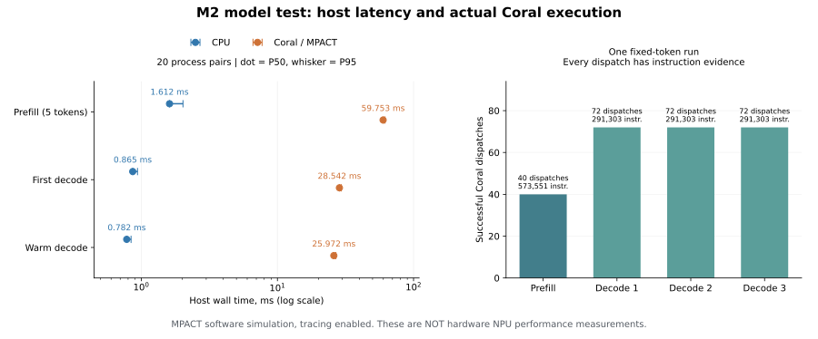

# M2 模型集成测试与性能报告

日期：2026-11-16。对象：`ggml-coral` adapter + `coral-llama-runner`，Linux x86_64 / Ubuntu 22.04 / WSL2 / MPACT。

**结论：固定小模型的 CPU/Coral 数值对照和真实 NPU 模拟执行已通过。当前 MPACT 路径没有本机速度优势：
热 decode 中位数 25.972 ms/token，CPU 为 0.782 ms/token，
约慢 33.2 倍。该比较描述带 trace 的软件模拟运行，不能推断真实 Coral 硬件性能。**

## 1. 测试对象与输入

- 原始测量时的 Git 基点为 `fa601d7`，当时 runner 与测试脚本尚未提交；现已提交为 `34aecf0`。
  完整源码/可执行文件/VMFB SHA256 见 [证据清单](m2-test-evidence.json)，保留原始测量身份。
- 模型：`stories260K-f32.gguf`，1,185,376 字节，词表 512；
  SHA256：`270cba1bd5109f42d03350f60406024560464db173c0e387d91f0426d3bd256d`。
- runner 二进制 SHA256：`d431b5c66c59972650bdb2281cfc579aaac409f7c3b211ca88ed4a9fe93986c7`。
- prompt：`Once upon a time`；prefill token 为 `[1,403,407,261,378]`；
  后续 decode 输入固定为 `[432,383,286]`。每条路径保存 4×512=2048 个 logits。
- 单线程，关闭 Flash Attention、权重 repacking，F32 KV cache；两种模式使用同一模型和相同 token。
- 9 个 shape 的 VMFB 提前编译，Coral fast math 关闭，允许 Zvt，默认 8 KiB ITCM / 32 KiB DTCM，
  未开启 highmem。依赖 revision 与参数依据 [依赖锁](../dependencies.lock.json)。
- Coral 接管部分为严格 F32 matmul。CPU 保留算子的精度参数遵循 llama.cpp；
  例如 trace 中 `kq-0` 的 `op_params[0]=15`（BF16 请求），因此不宣称全模型每项计算都采用 F32 累加。

## 2. 功能与数值结果

| 检查项 | 结果 |
| --- | --- |
| 固定 token CPU 重放 | 2048 个 logits 完全一致 |
| CPU/Coral logits | 全部通过，最大绝对误差 `7.152557373046875e-6` |
| 冻结容差 | `abs(actual-reference) <= 1e-4 + 1e-4*abs(reference)` |
| 四步 argmax | 两条路径均为 `432,383,286,261` |
| Coral 数值调用 | 144 次完成，无失败 |
| dispatch 与指令证据 | 256 次 dispatch，256 份有效指令计数，共 1,447,460 条 kernel 指令 |
| IREE host executable 加载尝试 | 0；不代表 GGML CPU 保留算子为零 |
| runtime/observer 错误 | 0 |
| 热运行 | Decode 2/3 新模块加载为 0、显式 binding 分配为 0 |
| M1 回归 | CTest 的 M=1、16、32 三项全部通过 |

独立验证套件包含 3 个正例进程（CPU、CPU 重放、Coral）和 6 个拒绝进程。
额外重复测量运行 22 组 CPU/Coral（2 组预热、20 组计入性能），44 个进程全部通过数值和 dispatch 检查，
88 次逐步 argmax 对照一致。22 个 Coral 进程的调用、指令、缓存和逻辑搬运计数完全一致。

## 3. 实际执行证据

证据链包含编译 placement、GGML 节点事件和 MPACT 的 kernel 退休指令计数，
不能只凭后端名称证明 NPU 执行。

**编译器证据**：9 个 VMFB 的 placement 日志均将数值 dispatch 分配到 `coralnpu`。
例如 `m5_k64_n64.compile.log`：

~~~text
Affinity: coralnpu
  Dispatches: 1 (100.0%)
    Static: 1 (100.0%)
    Dynamic: 0 (0.0%)
~~~

**逐节点运行证据**：以下为原始 `trace.jsonl` 的真实字段节选，没有重算 dispatch 或指令数：

~~~json
{"step": 0, "phase": "prefill", "name": "Qcur-0", "op": "MUL_MAT", "placement": "CORAL", "m": 5, "k": 64, "n": 64, "dispatches": 1, "instructions": 1116, "weight_cache_hit": false}
{"step": 1, "phase": "decode", "name": "Qcur-0", "op": "MUL_MAT", "placement": "CORAL", "m": 1, "k": 64, "n": 64, "dispatches": 2, "instructions": 4206, "weight_cache_hit": true}
~~~

这显示同一 Q projection 在 prefill 和 decode 都实际执行在 Coral：
M=5 时 1 次 dispatch / 1,116 条指令，M=1 时 2 次 dispatch / 4,206 条指令。
dispatch 数不是矩阵乘数量；Zvt 允许也不等于每个 shape 都使用矩阵指令。

**每阶段对账**：

| 阶段 | Coral matmul | dispatch | kernel 指令数 | 模块加载 | 权重缓存命中 | 显式 binding 分配 |
| --- | ---: | ---: | ---: | ---: | ---: | ---: |
| Prefill (5 tokens) | 36 | 40 | 573,551 | 7 | 0 | 43 |
| Decode 1 | 36 | 72 | 291,303 | 2 | 36 | 2 |
| Decode 2 | 36 | 72 | 291,303 | 0 | 36 | 0 |
| Decode 3 | 36 | 72 | 291,303 | 0 | 36 | 0 |

计数来自 runtime 的 [EndDispatch](../src/runtime/matmul_runtime.cc)：
完成状态由 HAL observer 接收，指令数读取 `INSTRET_KERNEL` 有效字段；
运行返回前检查 dispatch 成功、样本完整和非零指令数。
adapter 将事件关联回 GGML 节点，验证脚本对逐节点与每步统计求和核对。

每步有 36 个矩阵乘交给 Coral，另外 80 个数值节点留在 CPU，其中 10 个是 attention 矩阵乘；
还有 embedding/GET_ROWS、RMSNorm、RoPE、softmax、KV 写入、GLU、逐元素乘和残差加等。
矩阵乘节点覆盖率为 36/46=78.3%，**这是节点数量占比，不是 FLOPs、耗时或加速比例**。
CPU placement 的判断依据是仅注册 CPU 与 CORAL，且该节点没有 Coral 成功执行事件。

## 4. 性能测量方法与结果

使用现有 runner，不修改或重新编译计算代码。2 组预热后计入 20 组独立进程对照；
CPU/Coral 顺序交替，所有进程重放同一 token 文件，推理 PATH 中没有编译器或 shell。
没有清空操作系统页缓存；每个新进程的 runtime/模块/权重缓存从空开始。
热 decode 指同一进程的第 2、3 次 decode，共 40 个观测；它们不是 40 个相互独立的进程。
未固定 CPU 亲和性、电源状态和其他系统负载，结果用于本机诊断。

P50 是中位数，P95 采用位置 `(n-1)*0.95` 的线性插值。
进程结束使用 Linux pidfd 事件等待，避免超时轮询给短进程增加虚假延迟。
试测文件仍保留并标记 superseded；本报告仅使用 `paired-h67yxncp` 的最终数据。

### 主机墙钟耗时（ms）

| 测量区间 | CPU P50 | CPU P95 | Coral MPACT P50 | Coral MPACT P95 |
| --- | ---: | ---: | ---: | ---: |
| 首次 prefill，5 tokens | 1.612 | 2.025 | 59.753 | 61.649 |
| 首次 decode，1 token | 0.865 | 0.938 | 28.542 | 29.453 |
| 热 decode，每 token | 0.782 | 0.841 | 25.972 | 26.894 |
| 四步推理耗时之和 | 4.076 | 4.473 | 140.750 | 145.407 |
| 整个进程 | 19.113 | 21.020 | 157.020 | 163.013 |

计时边界：

- 每步 `wall_ms` 从 `llama_decode` 前计时，包含本步模块/权重准备、CPU 保留算子、IREE/MPACT、
  数值检查、逐节点 trace 写入及最后一行 logits 拷贝/写入；不含初始模型加载/context 创建，也不含随后 step 摘要写入。
- 整个进程从启动到退出，包含动态库/模型加载、context 创建、推理、文件收尾和释放；
  还包含 `/usr/bin/time` 包装器的开销。它不是“纯模型加载时间”。
- `invoke_ms` 只包围 `iree_vm_invoke`，包含 VM/HAL/MPACT 调用及其内部工作；
  不含 adapter 外层 activation 上传和输出回读。没有细分内部 simulator 计算与 staging。

由热 decode P50 的倒数换算，CPU 约 **1279.2 token/s**，
MPACT 约 **38.50 token/s**。这是带逐节点观测的软件运行速率，
不等于经过优化的 llama.cpp benchmark，也不代表真实 NPU token/s、TOPS、功耗或 RTL 周期。

Coral 热 decode 中 `invoke_ms / wall_ms` 的中位数为 **96.07%**。
因此主机时间主要落在 VM 调用区间；现有计数无法进一步归因到某个内部阶段。
9 个模块的累计加载时间 P50 为 **0.662 ms/进程**；
热运行仍有显著模拟执行开销，不能将慢速简单归因于重复加载。

### 内存与逻辑搬运

Linux `/usr/bin/time` 测得整个进程 peak RSS 的 P50：
CPU **17.57 MiB**，
Coral MPACT **27.21 MiB**。
RSS 包含宿主库、模型和模拟器，不能当作 NPU SRAM 占用。

| 阶段 | host→HAL 逻辑字节 | HAL→host 逻辑字节 | 新权重快照 |
| --- | ---: | ---: | ---: |
| Prefill | 1,088,368 | 55,520 | 36 |
| Decode 1 | 11,376 | 14,048 | 0 |
| Decode 2 | 11,376 | 14,048 | 0 |
| Decode 3 | 11,376 | 14,048 | 0 |

初始 prefill 准备 36 份权重，后续 108 次调用全部命中缓存。
Decode 2/3 仍有每步 11,376 字节上传和 14,048 字节回读；
这说明复用了权重快照，不代表 activation 或权重已经常驻设备内存。
`binding_allocations=0` 仅指 adapter 显式 input/weight buffer，不是全系统零分配。
当前没有完整 DDR/TCM 流量、设备峰值内存、周期或能耗测量。

### 按 shape 的指令分布

| 阶段 | M×K×N | matmul 次数 | dispatch | kernel 指令合计 |
| --- | --- | ---: | ---: | ---: |
| Prefill | 1×64×172 | 2 | 4 | 27,172 |
| Prefill | 1×64×512 | 1 | 2 | 33,478 |
| Prefill | 1×172×64 | 1 | 2 | 11,863 |
| Prefill | 5×64×32 | 10 | 10 | 6,630 |
| Prefill | 5×64×64 | 10 | 10 | 11,160 |
| Prefill | 5×64×172 | 8 | 8 | 472,456 |
| Prefill | 5×172×64 | 4 | 4 | 10,792 |
| 每次 decode | 1×64×32 | 10 | 20 | 20,590 |
| 每次 decode | 1×64×64 | 10 | 20 | 42,060 |
| 每次 decode | 1×64×172 | 10 | 20 | 135,860 |
| 每次 decode | 1×64×512 | 1 | 2 | 33,478 |
| 每次 decode | 1×172×64 | 5 | 10 | 59,315 |

prefill 不全是 M=5；以实际图为准，其中也包含 M=1 节点。
M=5/K=64/N=172 的 8 次调用占 prefill 指令数约 **82.4%**，是后续检查生成代码与 tiling 的候选。
指令占比不是耗时占比；尚未验证它是否为真实硬件瓶颈。

## 5. 失败路径证据

以下都由独立进程验证，未生成成功 `summary.json`；“已有输出目录”用例保留原有成功文件及内容：

| 用例 | 结果 | stderr 摘录（路径已脱敏） |
| --- | --- | --- |
| 已有输出目录 | 通过：非零退出，无成功结果 | `coral-llama-runner: --output must be a new directory; previous results are preserved` |
| token 文件缺少输入 | 通过：非零退出，无成功结果 | `coral-llama-runner: invalid or missing replay token` |
| token 超出词表 | 通过：非零退出，无成功结果 | `coral-llama-runner: replay token is outside this model's vocabulary` |
| manifest 指向缺失 VMFB | 通过：非零退出，无成功结果 | `coral-llama-runner: filesystem error: cannot make canonical path: No such file or directory [<workspace>/build/m2-results/runner-zo4vb2ki/missing-artifacts/missing.vmfb]` |
| 无匹配 shape、全部留在 CPU | 通过：非零退出，无成功结果 | `coral-llama-runner: Coral mode requires actual NPU dispatch in every prefill/decode step` |
| shape 匹配但 VMFB 损坏 | 通过：非零退出，无成功结果 | `coral-llama-runner: llama_decode failed (-3): load VMFB: iree/runtime/src/iree/vm/bytecode/archive.c:106: INVALID_ARGUMENT; FlatBuffer data is not present or less than 16 bytes (10 total)` |

缺失/损坏产物不会伪装为成功运行；没有实际 NPU dispatch 的 Coral 模式也会失败。
这些是 runner 集成测试；后续补齐的独立 adapter 边界测试见 [验收记录](m2-adapter-validation.md)。

## 6. 可追溯文件与复现

便于公开阅读的 [结构化证据清单](m2-test-evidence.json) 保存源码/模型/二进制/VMFB SHA256、
统计、原始节点字段和失败摘录；不包含用户名、绝对路径或主机名。

以下链接指向本机已保留、被 Git 忽略的原始产物，GitHub 上不会随源码一起存在：

- [功能验证 JSON](../build/m2-results/runner-zo4vb2ki/verification.json)
- [Coral 逐步结果](../build/m2-results/runner-zo4vb2ki/coral/steps.jsonl)
- [Coral 完整节点 trace](../build/m2-results/runner-zo4vb2ki/coral/trace.jsonl)
- [最终性能汇总](../build/m2-benchmarks/paired-h67yxncp/summary.json)
- [逐次测量 CSV](../build/m2-benchmarks/paired-h67yxncp/measurements.csv)
- [全部测量记录 JSON](../build/m2-benchmarks/paired-h67yxncp/runs.json)
- [示例编译 placement 日志](../build/m2-artifacts/model-aot-c2u8iuxg/m5_k64_n64.compile.log)
- [M1 CTest 记录](../build/m1/Testing/Temporary/LastTest.log)

在 WSL 项目根目录复现，不需要清理、重建或重新编译 VMFB：

~~~bash
source ./env.sh
python tests/ggml/verify_runner.py \
    --runner build/m1/coral-llama-runner \
    --model models/stories260K-f32.gguf \
    --artifacts build/m2-artifacts/model-aot-c2u8iuxg

python tests/ggml/benchmark_runner.py \
    --runner build/m1/coral-llama-runner \
    --model models/stories260K-f32.gguf \
    --tokens build/m2-results/runner-zo4vb2ki/cpu/tokens.txt \
    --artifacts build/m2-artifacts/model-aot-c2u8iuxg \
    --repeats 20 --warmup-pairs 2
~~~

每次新建结果目录，旧产物和缓存保留。跨机器准备方式见 [runner 说明](m2-runner.md)。

## 7. 验收边界与后续

本报告确认小模型推理调用链、严格 F32 Coral matmul、固定 token 数值对照、实际 dispatch、
权重复用以及 runner 失败传播。后续 [独立 adapter 验证](m2-adapter-validation.md) 已补齐
原计划的 dtype/stride/广播/precision/可变权重等边界：23 个独立进程、95 项检查全部通过。
两份报告共同满足当前 M2 / v0.1 功能验收范围。未覆盖其他模型、长上下文、多线程/并发、
完整模型 RVV-only 对照及硬件执行。本报告性能数据未变，仍对应原始测量。

后续性能工作宜先细分 VM 调用内的耗时，再检查高指令数 shape；FFN 融合与减少中间回读
是可测的优化方向。当前数据没有证明这些改动的收益，也不能以本机模拟器时间选择真实硬件最优方案。
