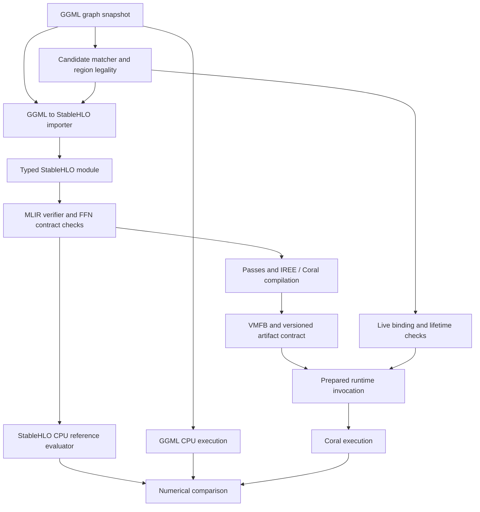

# M3: FFN interfaces and semantic contract

Status: **step 1 design contract**, accepted architecture, version 1.
The accompanying headers define metadata only. The graph exporter, importer,
planner checks, reference runner, compiler integration, and FFN runtime are
subsequent work. No M3 execution or acceptance result is claimed here.

This document defines the M3/M4 boundary and supersedes the earlier proposal
for a private computational IR followed by a separate StableHLO exporter.
M1/M2 APIs and artifacts retain their existing meaning.

## Architecture decision

Use StableHLO as the computational IR at the GGML/compiler boundary. Retain
all four responsibilities: typed representation, verification, CPU reference
evaluation, and GGML region legality. Reuse MLIR/StableHLO implementations
where they apply; implement the GGML semantic bridge and integration checks.

The decision is based on established architecture and extensibility:

- [ExecuTorch delegation](https://docs.pytorch.org/executorch/stable/compiler-delegate-and-partitioner.html)
  separates graph partitioning, backend preprocessing/compilation, and runtime
  initialization/execution.
- [TVM BYOC](https://tvm.apache.org/docs/arch/external_library_dispatch.html)
  identifies supported computation patterns and delegates regions to external
  code generation.
- [Coral's MLIR/IREE architecture](https://developers.google.com/coral/guides/software/mlir-iree-compilers)
  accepts standard frontend representations and progressively lowers them
  through representations appropriate for hardware optimization.
- The [StableHLO reference interpreter](https://openxla.org/stablehlo/reference)
  provides reference operation semantics. It is a test oracle, not the
  production CPU fallback or a CPU performance baseline.

These are architecture precedents, not a claim that an existing package
already implements our complete GGML-to-Coral integration.



Candidate semantics can be imported and evaluated before a schedulable plan
exists. CPU evaluation is a validation branch, not a prerequisite execution
on every inference call.

## Ownership and module boundaries

| Component | Owns or validates | Reuses |
| --- | --- | --- |
| GGML adapter | Source tensor lookup, capabilities, scheduler integration, live bindings | GGML graph, scheduler, allocator, CPU backend |
| Region planner | Pattern roles, graph boundaries, schedule/lifetime guards, rejection diagnostics | GGML subgraph-use checks where applicable |
| Compiler frontend | Source-to-IR mapping, source locations, FFN signature/subset checks | MLIR types/builders/verifier and existing StableHLO ops |
| Reference tooling | Test input conversion, CPU/IR comparisons and diagnostics | Pinned StableHLO interpreter and GGML CPU |
| Compiler service | Target support, pass configuration, artifact compatibility and publication | IREE/Coral lowering and code generation |
| Runtime adapter | Device/module/prepared-weight lifetime, binding validation and output publication | Existing IREE VM/HAL and Coral execution backend |

Compiler/MLIR libraries belong to compiler or test tools. Runtime metadata
headers must remain usable without GGML, MLIR, IREE, or simulator headers.
AOT and future JIT use the same compiler boundary; JIT changes when it is called.

The source definitions are [ffn_contract.h](../src/contracts/ffn_contract.h)
and [region_plan.h](../src/planner/region_plan.h). They introduce no private
operator graph, interpreter, or binary serialization of C++ structures.

C++ identifiers preserve the acronym `FFN` in uppercase, including types,
functions and constant prefixes: `FFNShape`, `MatchFFN` and
`kFFNContractVersion`.

## Version 1 scope

Accepted computation: a pure, single-output, ordinary parallel SwiGLU FFN.
All inputs, intermediates, outputs, and dot accumulation use F32. Shapes are
static and exact. M, D, and F must be positive; check arithmetic overflow before
computing element counts, strides, or byte sizes. Every external tensor and
M-by-F intermediate must fit the current signed 32-bit byte-addressing limit.
Target memory/tiling feasibility is a separate compiler check.

Initial validation profiles use M=1,16,32 with synthetic D=128,F=256 and the
pinned model's observed D/F (currently D=64,F=172). Other positive shapes may be
representable but are eligible for execution only after target/profile checks.
There are no implicit token buckets, dimension rounding, or padded ABI tensors.

Version 1 rejects bias, residual additions inside the region, clamps, scales,
LoRA branches, MoE, packed single-input GLU, alternative activations, quantized
or reduced-precision tensors, dynamic shapes, broadcasting, batched matmul,
and side effects. Reshape/transpose support is introduced only through an
explicit, verified importer rule; the initial FFN matcher does not absorb
arbitrary view or layout-changing nodes. Pad/crop specialization belongs to M5.

Weights are leaf tensors supplied as runtime parameters. Their values do not
form part of the standard computational IR or the code-cache identity.

## Tensor and function ABI

Contract identifier: `coral.ffn.f32.v1`. Public function: `ffn`.
One invocation takes four arguments, in the following exact order, and returns
one owned result. All boundary tensors use dense row-major F32 storage.

| Position / role | StableHLO logical shape | GGML ne[0..3] | Dense GGML nb[0], nb[1] in bytes |
| --- | --- | --- | --- |
| 0: X, activation | [M,D] | [D,M,1,1] | 4, 4D |
| 1: W_gate | [F,D] | [D,F,1,1] | 4, 4D |
| 2: W_up | [F,D] | [D,F,1,1] | 4, 4D |
| 3: W_down | [D,F] | [F,D,1,1] | 4, 4F |
| Result: Y | [M,D] | [D,M,1,1] | 4, 4D |

Require full GGML contiguity and singleton higher dimensions as well as these
row strides. Copying `ne` directly into a StableHLO shape reverses the intended
matrix interpretation. A tensor name is diagnostic metadata, never proof of
its semantic role.

The mathematical definition in this storage convention is:

```text
gate = X @ transpose(W_gate)       # [M,F]
up   = X @ transpose(W_up)         # [M,F]
silu = gate / (1 + exp(-gate))     # [M,F], elementwise
hidden = silu * up                # [M,F], no broadcasting
Y = hidden @ transpose(W_down)    # [M,D]
```

Each matmul uses `stablehlo.dot_general` with empty batching dimensions and
contracting dimensions `[1] x [1]`. Thus explicit physical weight transposes
are unnecessary for this ABI. A concrete signature for one validation profile:

```mlir
func.func @ffn(
    %x: tensor<16x128xf32>,
    %w_gate: tensor<256x128xf32>,
    %w_up: tensor<256x128xf32>,
    %w_down: tensor<128x256xf32>) -> tensor<16x128xf32>
```

This is a signature sketch, not a standalone executable module. The importer
must emit the actual function body using existing operations. It must not emit
an opaque custom FFN operation and assume upstream verification or evaluation
will understand its semantics.

The baseline SiLU lowering uses negate, exponential, an explicitly broadcast
F32 one, add, and divide; the following multiply forms SwiGLU. A replacement
such as multiply-by-logistic needs the same numerical validation as any other
rewrite. Dot precision is `[DEFAULT, DEFAULT]` with F32 operands/results and
a compiler policy forbidding reduced-precision substitution.

### Mapping the two GGML spellings

For `GGML_OP_MUL_MAT`, `src[0]` is the weight and `src[1]` the activation.
This differs from the exported function's activation-first argument order.

For split `GGML_OP_GLU`, require two same-shaped inputs,
`op_params[0] == GGML_GLU_OP_SWIGLU`, and `op_params[1] == 0`.
The pinned CPU implementation computes `SiLU(src[0]) * src[1]`:
`src[0]` is gate and `src[1]` is up. Validate all remaining parameter
words; unknown/non-default parameters are unsupported.

For expanded `UNARY(SILU) + MUL`, identify gate by the input of SILU.
The MUL may put the SILU result on either side. Require exact equal shapes;
GGML broadcasting capability does not expand this contract.

Both projections must use the identical activation tensor. Recover all roles
from edges and parameters, not names, layer numbers, or coincident shapes.
Gate and up weights may be equal or share an identical immutable leaf tensor;
role binding must still be preserved. Reject partial overlap and unproven aliases.

Matmul precision acceptance follows M2: default/F32 accumulator and source
precision only, no execution hints or unknown nonzero parameter fields.
Preserve the source settings in diagnostic metadata even when they lower to
the same F32 module.

Pinned source references:
[GLU construction](https://github.com/ggml-org/llama.cpp/blob/9fba51d2c9a1b5cb5f0c47986c031334e2d7663a/ggml/src/ggml.c#L2895),
[CPU SwiGLU](https://github.com/ggml-org/llama.cpp/blob/9fba51d2c9a1b5cb5f0c47986c031334e2d7663a/ggml/src/ggml-cpu/vec.cpp#L500),
[parallel FFN construction](https://github.com/ggml-org/llama.cpp/blob/9fba51d2c9a1b5cb5f0c47986c031334e2d7663a/src/llama-graph.cpp#L2022).

## Numerical policy and verification layers

Policy identifier: `f32-no-fast-math-v1`.

- Compile with Coral fast math explicitly disabled and record effective flags.
  Do not introduce F16/BF16/quantized arithmetic or lossy weight preparation.
- This policy does not promise bitwise agreement: dot reduction order,
  contraction, and transcendental implementations can differ.
- Initial correctness acceptance covers finite F32 fixtures with finite
  reference intermediates/results. Test normal, near-zero, negative, and
  saturated activation ranges. NaN/Inf or overflow cases must be reported
  explicitly and cannot pass through an `equal_nan` comparison.
- The runtime binding ABI specifies F32 storage, not a scan of every input
  value. Finite-value screening is performed by validation tools; unusual
  values are not silently clamped or replaced in inference.
- The proposed M3 acceptance threshold is elementwise
  `abs(actual-reference) <= 1e-4 + 1e-4 * abs(reference)` for the named
  intermediates and final FFN result. This is a requirement to validate, not
  an already measured M3 result. Keep existing M1/M2 thresholds unchanged.
- Record maximum absolute/relative error and failing indices. Compare GGML
  CPU with StableHLO reference, then both with Coral in M4. Tolerance failures
  require diagnosis and an explicit reviewed policy/test-contract change;
  never widen tolerances automatically. The tolerance is test metadata,
  not an extra runtime argument.

Keep three checks distinct:

1. MLIR/StableHLO verification: structure, types, attributes, and op constraints.
2. Project checks: allowed subset, exact signature, GGML parameter semantics,
   role bindings, region safety, and target/profile support.
3. Numerical evaluation: the imported program and its optimized/compiled
   forms agree with independently executed GGML computations within policy.

A verifier cannot detect swapped same-shaped weights. A reference interpreter
only evaluates the imported program; GGML CPU remains the source-semantics
oracle. Reference evaluation must not silently delegate unsupported ops to
custom callbacks. Diagnose missing pinned interpreter coverage in step 3.

## Candidate, plan, and executable are different states

| State | Required information | Authority |
| --- | --- | --- |
| FFNRegionCandidate | Graph snapshot, exact profile, pattern, role IDs, complete ordered member IDs | Describe/import a candidate; execute or skip no GGML nodes |
| FFNRegionPlan | Candidate plus validated graph, schedule, split and lifetime constraints | Request preparation for this exact graph/schedule |
| Prepared executable (M4) | Plan plus compatible loaded artifact, device and live bindings | Execute after per-call guard checks |

The headers are data definitions. Constructing an aggregate or deserializing
metadata does not establish a successful validation result.

IDs are nonzero deterministic traversal IDs within a graph snapshot. Live
snapshot instance/revision and schedule generation are process-local guards.
Persisted graph dumps may carry local node IDs for diagnostics but cannot be
loaded as executable plans. Rebuild/revalidate plans in each process.

Invalidate a plan after graph topology/op-parameter/shape changes, scheduler
repartitioning, allocation/alias changes, or observation-policy changes.
Changing activation values alone preserves the plan. Changing weight contents
requires new prepared weights even when the structural plan is unchanged.

Before creating a plan, prove:

1. Members are unique, form the complete accepted pattern, and are contiguous
   in the selected backend split's execution order. All projections and
   activation operations are assigned to that same Coral split.
2. Every external input is ready before the first member. Every member is
   pure, and no KV or other externally visible state is modified.
3. Non-output intermediates have no external consumers or graph-output flags.
   Use the original graph's use/alias information, not only a truncated split.
   Every external use must go through the declared Y result.
4. Member views, in-place updates, partial input overlap, output/input overlap,
   and other unproven aliases are rejected. Repeated references to the same
   read-only leaf weight are permitted; shapes alone never prove alias safety.
5. Per-node evaluation/debug callbacks disable fusion in v1. Report this
   reason and execute members normally; an observer is never silently dropped.
6. Invoke the fused function at the down-projection node. X and all weights
   remain valid through synchronous completion there. Establish allocator
   dependencies before allocation is finalized where the pinned GGML API
   supports it; otherwise reject fusion. Never assume a caller-held pointer
   prevents GGML storage reuse.
7. Missing member support/artifacts cannot be hidden by pattern recognition.
   Default GGML splitting happens before backend graph optimization; a
   CPU-assigned GLU is a real fusion boundary.

Use upstream `ggml_can_fuse_subgraph_ext` as one check, not the entire proof.
Version 1 rejects externally observed intermediates instead of adding a
multi-output artifact ABI. Boundary Y may have multiple downstream consumers.

## Interface operations

These are logical API contracts, not implemented function declarations.
Concrete wrappers should follow the pinned library APIs; do not introduce a
second generic IR or a generic interpreter just to match these names.

| Operation | Inputs -> result | Required behavior |
| --- | --- | --- |
| MatchFFN | Graph snapshot, root -> candidate or no match | Read actual edges/parameters; no graph mutation or device work |
| PlanFFN | Candidate, graph, schedule, capabilities -> plan or structured rejection | Perform all region guards; preserve graph and placement on rejection |
| ImportFFN | Graph snapshot, candidate -> owned MLIR module and source map or diagnostic | Check snapshot and source semantics; map actual graph; no requirement for device placement |
| VerifyFFN | Module, compile spec -> success or diagnostics | Run upstream verifier and project signature/subset checks; no execution |
| EvaluateReference | Verified module, owned test inputs -> owned outputs or diagnostic | Pinned StableHLO interpreter only; separate tool/test process |
| CompileRegion | Verified module, spec, target, toolchain -> validated artifact or diagnostic | Same entry for AOT/JIT; compiler worker owns MLIR lifetimes |
| PrepareFFN | Plan, artifact, device, live tensor/weight bindings -> prepared executable or error | Check compatibility, graph/schedule freshness and ownership |
| RunFFN | Prepared executable, current activation binding -> owned Y or error | Recheck live guards, execute synchronously, publish only after success |

No-match is ordinary pattern discovery. Rejection includes a stable reason
code and optional source tensor ID. Malformed input, compiler failures, and
runtime failures remain explicit diagnostics/errors rather than no-match.
GGML C callbacks continue to contain exceptions.

Source maps connect graph-local IDs to IR locations and later placement
evidence. They carry no live pointers or absolute source paths. Keep them
separate from canonical semantic identity so layer names do not prevent code
reuse. MLIR modules and contexts stay within the owning compiler/test process.

## Compilation and artifact boundary (implemented in M4)

`CompileRegion` consumes the verified StableHLO module, `FFNCompileSpec`,
target profile, and toolchain identity. FFNCompileSpec alone is not a program.
The compiler validates support and placement in addition to general IR validity.

The artifact contract must record:

| Field group | Required contents |
| --- | --- |
| Contract | Manifest schema, FFN ABI/version, entry point, ordered I/O roles and exact types/layouts |
| Program | Canonical semantic IR identity, importer/pass-pipeline identity, numerical policy |
| Toolchain | Compiler/IREE/LLVM/StableHLO revisions and applied patch/config identities |
| Target | Host requirements, target ISA/features, ABI, ITCM/DTCM, CRT/linker identity |
| Integrity | VMFB digest, supporting file digests, complete-publication marker/schema |
| Placement | All numerical operations on Coral for complete-FFN mode, with source correspondence |

M4 defines the wire schema, reflection encoding, serialization and loader.
The compiler must emit matching module signature/contract metadata; loading
checks it against the manifest and the requested profile. Do not relabel an
M1 `matmul` VMFB or M2 `profiles.tsv` as a valid four-input FFN artifact.

Use `region.stablehlo.mlir` for computation and optional `region.metadata.json`
for binding/source-map diagnostics. There is no `region.ir.json` containing
a competing private computational language.

Code-cache identity includes semantic IR, ABI, exact shapes/types/layouts,
numerical policy, compiler/passes/patches, and effective target configuration.
Exclude source node names, local paths, pointers, activation values, and
external weight values. Canonicalization/hash serialization is implemented in
M5; debug names must not accidentally determine the semantic digest.

Loaded-module identity additionally includes device/runtime context.
Prepared-weight identity includes model/tensor identity or content identity,
mutation generation, layout and device lifetime. Same-shaped layers can share
code; they cannot accidentally share weight snapshots. If a future optimization
embeds or specializes on values, those values become part of code identity.

Unknown versions, mismatched ABI/target/profile, incomplete publication, or
bad checksums are rejected before execution. Required numerical computation
on the host makes an artifact hybrid; it cannot satisfy complete-FFN offload.

## Runtime binding and failure boundary

The existing M1 `LoadedModule::Run(X, W)` remains a matmul interface. An FFN
invocation needs a distinct four-input signature and three prepared weights;
it must not be disguised as a larger `MatmulShape`.

- Execution remains synchronous and confined to one host thread per context.
  The device outlives loaded modules and prepared weights.
- Runtime inputs are borrowed dense F32 bindings; validate exact shape,
  element count, byte strides, capacity and device association before dispatch.
  X stays alive and unchanged until completion.
- Prepared weights are owned immutable snapshots. With the explicit immutable
  model-weight promise they may be reused. Without that promise, refresh
  snapshots before a graph invocation; binding guards prevent stale reuse.
- Graph IDs resolve through an adapter-owned live lookup. No GGML pointers or
  allocation ownership cross the serialized compiler/artifact boundary.
- Y is produced in isolated owned storage. Publish into the GGML destination
  only after invocation, output ABI checks, required device evidence and
  readback succeed. Intermediate results are not published by the fused path.
- A failed device invocation follows M1's poisoned-context policy: report the
  failure and rebuild the context before further execution. It must not be
  disguised as a successful CPU fallback.

| Condition | Required action |
| --- | --- |
| Unsupported operation/profile before scheduling | Keep it on a supported backend, normally GGML CPU |
| FFN pattern/legality fails, or region artifact is known absent before execution | Keep the already legal member execution plan; do not skip nodes |
| Member capability is absent | Do not claim support or force a split across the unsupported node |
| Candidate has a CPU GLU or multiple splits | Reject fusion; retain scheduler placement |
| Selected artifact is corrupt/incompatible, or live bindings/plan are stale | Return an error before output publication |
| Device execution fails or may have partially completed | Return an error, invalidate the context, and do not transparently replay |

AOT capability queries use an in-memory catalog, with no compilation, file I/O,
device allocation, or numerical execution. Interpreter success does not make
an operation eligible for the Coral backend. M5 may introduce an explicit JIT
preparation policy; it must preserve these error and ownership boundaries.

## Implementation sequence and acceptance

| Step | Deliverable | Gate |
| --- | --- | --- |
| 1 (this change) | Metadata headers and semantic/interface contract | Consistent ABI, ownership, failure behavior and milestone boundaries |
| 2 | Real GGML graph export | Reconstruct actual FFN edges, parameters, uses and placement without addresses |
| 3 | StableHLO builder/verifier/reference integration | Valid small modules evaluate; malformed modules fail; pinned coverage recorded |
| 4 | Per-op GGML importer | Each supported mapping agrees with GGML CPU and preserves parameters |
| 5 | Candidate matcher and legality checks | Both FFN spellings recognized; unsafe cases rejected with reasons |
| 6 | Standalone member support and placement | Every assigned member executes legally; real FFN can occupy one split |
| 7 | Full-region import and M3 acceptance | Real/synthetic FFN reference agreement and complete negative/lifetime cases |
| M4 | AOT FFN artifact, independent runner, then GGML execution | Three-way numerical agreement, artifact compatibility and real device evidence |
| M5 | Shared AOT/JIT service, cache and optimization passes | Invalidation, before/after IR and numerical/structural evidence |

At step 5, split/lifetime tests may use synthetic schedule fixtures. Actual
schedulability is established at step 6 and is mandatory before execution.
M3 acceptance includes same-shaped distinct weights, swapped-role detection
through numerical tests, external consumers, graph outputs, aliases, debug
callbacks, stale plans, tail dimensions and prefill/decode profiles.

Implementation locations: `src/contracts/` for shared metadata,
`src/planner/` for region reasoning, `src/ggml/` for graph and live bindings,
`compiler/` for standard IR tooling, and `src/runtime/` for invocation owners.
New compiler/reference tests belong under `tests/compiler/` and planner tests
under `tests/planner/` when those implementations are added.

The initial integration must establish compatibility with the pinned StableHLO
builder/interpreter. It must not claim coverage merely because the source is
present. Semantic rewrites belong in MLIR passes with before/after verification
and numerical tests; hardware scheduling belongs at the appropriate IREE
lowering level. A new dialect requires a demonstrated semantic need and its own
verification, evaluation and lowering plan.
