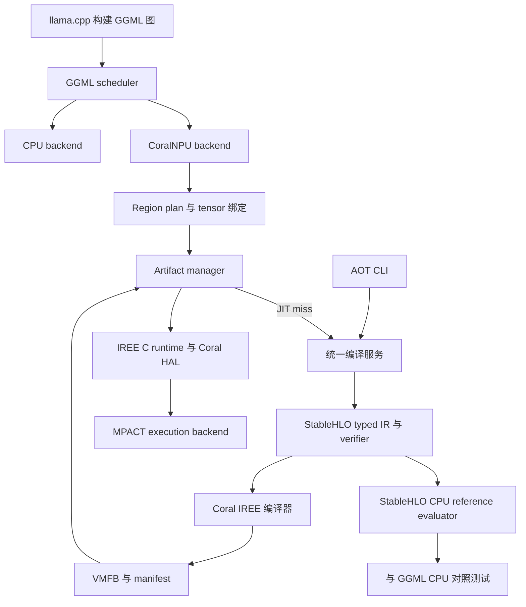

# 开发计划与版本约定

> 版本约定更新（2026-11-16）：M1、M2 等标记表示开发里程碑，M2 验收不等于发布 v0.1.0。
> 首个 v0.1.0 计划在 SoC 集成完成后再发布。下文保留原方案中的 v0.1/v0.2/v0.3
> 阶段标签，供理解原始工作分组；它们不再代表 GitHub release 版本或承诺的发布顺序。
> 原阶段中的 FFN、AOT/JIT、W8A8/W4A8 和驱动要求仍然有效。

项目目标是在不购买硬件的 Linux 环境中，为 llama.cpp 开发 CoralNPU 后端，把 GGML 中受支持的矩阵乘和 SwiGLU FFN 子图编译为设备可执行产物，在 IREE runtime 与 MPACT 上运行；进一步完成 AOT/JIT、IR 优化、调度、内存与权重缓存，并将 W4A8（packed INT4 权重、INT8 activation）的设备端解包和混合精度执行纳入 v0.2 必做范围。后续扩展到 Renode 中的 ARM Linux 驱动集成。

项目沿用此前 Tenstorrent 方案的分层与验收方式，但 CoralNPU 版从第一个矩阵乘实验开始使用编译产物：v0.1 交付 F32 可运行后端；v0.2 必须交付 FFN 编译、AOT/JIT、缓存、调度，以及 Q1 W8A8 基线和 Q2 W4A8 packed-weight 真正设备执行；v0.3 交付 Linux 驱动实验。W4A8 不要求改 RTL 原生 INT4 PE，而是由 NPU 端解包后复用整数计算路径。阶段、接口、目录和工时均为项目设计；资料基线日期为 2026 年 11 月 15 日，实际工具链组合在 M0 验证后固定。

# 一 项目背景

前面对 Ethos-U 的讨论已经涉及三个不同层次：推理引擎生成计算图，编译器产生设备程序，runtime 和 driver 负责加载、内存与执行控制。这个项目把这些边界变成自己可以实现、观测和验证的模块。

CoralNPU 的官方工具链提供 IREE/MLIR 编译路径、RISC-V 目标代码和模拟器 HAL。其硬件、编译器及 MPACT 模拟器都有公开仓库，可以在没有开发板的条件下研究前端适配、编译与执行。[编译器架构](https://developers.google.com/coral/guides/software/coral-mlir-compiler)；[硬件仓库](https://github.com/google-coral/coralnpu)；[MPACT 仓库](https://github.com/google-coral/coralnpu-mpact)

本项目的主要贡献是 GGML 接入、子图语义转换、编译产物契约、缓存、内存生命周期和跨层观测。官方 Gemma 示例用于理解已有工具链和排查环境；主项目仍由 llama.cpp 负责 GGUF、模型构图、分词与生成流程。[Gemma 示例](https://github.com/google-coral/coralnpu-compiler/blob/main/examples/gemma_common/README.md)

MPACT 用于日常功能开发；Verilator 用于少量 RTL 实验；Renode 用于 ARM Linux 与设备交互。MPACT 的执行时间不作为真实硬件吞吐的预测。RTL 周期结果也需要结合实际内存和系统模型解释。[模拟器说明](https://developers.google.com/coral/guides/software/simulator)

# 二 目标和完成标准

| 版本 | 交付能力 | 完成证据 |
| - | - | - |
| v0.1 后端集成 | 二维 F32 MUL_MAT 经 AOT 产物进入 MPACT；小型 GGUF 模型完成短 prefill 和 decode | CPU 数值对照、真实 NPU dispatch、节点分配日志、长期存活的 C/C++ runtime |
| v0.2 编译、调度与 W4A8 | 闭合 SwiGLU FFN、typed IR、统一 AOT/JIT、缓存、IR 优化、权重复用；必须新增 Q1 W8A8 数值基线与 Q2 packed W4A8 设备端解包/INT8 计算 | FFN 与 W4A8 真实 NPU dispatch、逐 group 数值参考、压缩权重传输报告、跨进程复用、缓存失效、placement 与数据移动证据 |
| v0.3 Linux 驱动 | Renode ARM Linux 中的 platform driver、设备程序执行、完成与错误处理 | 从用户态到 MMIO 的调用链、受控小程序、超时和复位测试、可复现补丁 |
| 后续系统接通 | IREE 的 Linux execution backend 接到上述 driver | ISA、内存与 dispatch ABI 对齐后，先运行编译的小 kernel，再运行 GGML backend |

v0.2 是编译器、推理系统与量化执行方向的核心成果，其中 Q2 W4A8 是正式必做，不再放在未来选修。v0.1 仍限定 F32；v0.2 依次验证 W8A8，再实现 packed W4A8。完整覆盖 Linux 内核驱动目标需要 v0.3；现有 IREE 用户态 HAL 与 Linux kernel driver 分别验收。

最终演示使用同一模型和固定 token 输入，对比 CPU、逐算子 AOT、FFN AOT、首次 JIT 与缓存命中。每种模式都给出实际计算位置，不能用“GGML 已分配给 Coral backend”代替 NPU 执行证据。

# 三 初始范围和技术选型

| 项目 | 初始选择 | 原因 |
| - | - | - |
| 主机 | Linux x86_64，优先固定容器；Windows 可通过 WSL2 开发 | 先减少主机平台变量 |
| 日常设备模型 | MPACT-CoralNPU，单设备、同步执行 | 快速定位语义和 runtime 问题 |
| 推理引擎 | 固定 revision 的 llama.cpp/GGML | 复用成熟的模型加载与构图 |
| 编译链 | GGML region → StableHLO typed IR → Coral IREE compiler | 复用成熟 IR、verifier 和参考解释器，明确 GGML 语义桥接边界 |
| 正式执行入口 | C/C++ 调用 IREE runtime 和已有 Coral HAL | 避免每个算子启动命令行进程 |
| 编译产物 | module.vmfb、manifest、IR 和 placement 报告 | 统一 AOT/JIT 的执行接口 |
| 首个模型 | stories260K-f32.gguf | 用很小的真实模型完成集成 |
| 初始精度 | v0.1 F32 输入、权重和输出，显式关闭 Coral fast math | 将布局错误与精度近似分开定位 |
| v0.2 INT8 基线（Q1） | 对称 W8A8，INT8×INT8，INT32 分组累加、FP32 scale 合并 | 验证原生整数执行路径与量化数值语义 |
| v0.2 必做量化（Q2） | signed INT4 packed 权重＋INT8 activation，group size 首选 64；NPU 端按 tile 解包为 INT8 计算 | 同时验证模型准备、编译 lowering、设备执行与权重传输收益 |
| 初始 shape | exact M=1、16、32；D/F 来自合成测试和实际模型 | 覆盖 decode 与短 prefill |
| 首个完整子图 | 无 bias 的 SwiGLU FFN，边界在 RMSNorm 后、residual add 前 | 无 KV 写入，适合建立安全执行边界 |
| 其余计算 | attention、RoPE、KV cache、embedding 等先留在 CPU | 控制动态状态与首版范围 |
| 驱动环境 | Renode 的 ARM Linux 与 CoralNPU 示例 | 练习 SoC 中的 platform device 集成 |

v0.1 不加入 GGUF Q4/Q8、MoE、多设备、异步多队列和完整 attention offload。v0.2 必须实现 Q1 W8A8 与 Q2 W4A8，但首个 W4A8 权重格式由本项目从 F32 GGUF 权重离线量化生成，不要求直接兼容 GGUF 的 Q4_0、Q4_K 或其他 block encoding；这些格式的直接 importer 仍为未来扩展。BF16 是另一条独立数值 profile，不是 Q2 的依赖。

模型从 [ggml-org 测试模型仓库](https://huggingface.co/ggml-org/test-model-stories260K/tree/main) 获取，在 M0 固定文件 revision、SHA256、tokenizer 与模型元数据。合成小 DAG 用于控制尺寸和异常条件，真实 GGUF 用于验证集成。

内存配置先采用选定工具链的默认 profile；需要 highmem 时建立独立 profile，并同时固定 linker、ITCM、DTCM 和外部内存布局。扩大模拟内存后的结果只代表该 profile，不能写成默认 IP 配置已通过。

# 四 架构和模块职责



AOT 与 JIT 复用同一个编译函数，差别是调用时机。第一阶段每个 matmul 对应一个小 artifact；后续用完整 FFN artifact 替换多个单算子调用。主进程长期持有 runtime、设备、session 和已加载模块。

| 模块 | 本项目负责 | 上游复用 |
| - | - | - |
| GGML adapter | device 注册、supports_op、tensor 映射、graph_compute、路由诊断 | GGML scheduler 与 CPU backend |
| Region planner | FFN 匹配、边界与外部使用检查、shape guards、执行计划 | 固定版本的 GGML 图结构 |
| Compiler frontend | GGML→StableHLO importer、函数 ABI/子集检查、数值对照与来源映射 | MLIR/StableHLO types、builders、verifier、reference interpreter；Coral IREE lowering 与 LLVM codegen |
| Artifact manager | manifest、compatibility、cache key、AOT/JIT、原子发布 | VMFB 格式及 IREE module 加载 |
| Runtime adapter | 资源 owner、输入输出绑定、权重准备、buffer 复用和计数 | IREE C API、Coral HAL、MPACT |
| Linux integration | platform driver、UAPI、设备加载协议、Linux execution backend | Renode 平台、Coral 控制寄存器与接口 |

IREE HAL 与底层 execution backend 是后续 transport 的扩展点。当前 `runtime/driver/coralnpu_exec_backend.h` 定义 dispatch 接口；可以在其下增加 Linux 实现。接口存在不等于平台已经兼容，还需要验证加载格式、地址空间和 dispatch ABI。[执行接口](https://github.com/google-coral/coralnpu-compiler/blob/main/runtime/driver/coralnpu_exec_backend.h)

# 五 版本固定和前置可行性验证

以 coralnpu-compiler 的一个 revision 为依赖根，使用其配套 IREE、LLVM、CoralNPU、MPACT 和补丁集。llama.cpp、Renode、Linux guest 单独固定。先遵循该 revision 的官方构建脚本，不把多个仓库的 latest 任意组合。[构建入口](https://github.com/google-coral/coralnpu-compiler#build---bazel)

`toolchain.lock` 记录 compiler、IREE、LLVM、MPACT、硬件与 llama.cpp revision，本地 patch 身份，容器 digest，宿主编译器，构建选项，host triple/features，NPU ISA，linker script、CRT 和内存配置校验值。

M0–M1 验证四个假设：

1. 选中的 compiler 与 MPACT 组合能够编译、运行小 matmul。

2. 自己的 C/C++ runner 能调用同一产物并返回正确结果。

3. M=1 与 prefill 两类计算确实进入 NPU。

4. Renode 系统路径可独立启动，其 ISA、内存和控制接口差距可列清楚。

先用官方 `examples/matmul-aot/test_matmul.sh` 建立基线，再替换输入和 shape。脚本已经包含 Zvt 与 RVV-only 两条编译路径，可用于理解执行差异。[官方 matmul 示例](https://github.com/google-coral/coralnpu-compiler/blob/main/examples/matmul-aot/test_matmul.sh)

不把运行完整 Gemma 当作环境验收条件。首先记录首次构建时间、峰值内存、磁盘占用与小测试耗时；必要时控制构建并行度，避免环境问题和模型问题同时出现。

# 六 分阶段执行计划

## M0 固定环境并建立基线

**任务**

1. 创建项目仓库、固定依赖与构建入口，保存工具链和 target profile。

2. 运行 stories260K 的纯 CPU 基线，保存 prompt、token IDs、模型 shape 与 logits。

3. 运行官方小 matmul 的 RVV 与 Zvt 路径，保存编译配置、placement 和执行日志。

4. 加入 M=1、非方阵及零矩阵测试，避免只用方阵掩盖维度方向错误。

5. 编译 F32 baseline，显式使用 `--coralnpu-fast-math=false`。

6. 对 Renode Linux demo 做早期探针，只确认启动和设备交互，记录后续兼容性工作。

**验收**：工具链组合可复现；CPU 与 MPACT 均产生实际结果；关键计算的 NPU placement 和执行事件一致；环境消耗可量化。

**交付**：`toolchain.lock`、环境脚本、`smoke_compiler`、`smoke_mpact`、CPU golden 数据、系统兼容性清单。

## M1 独立 runtime 与数值契约

**任务**

1. 用自己生成的小 StableHLO matmul 编译 VMFB，权重作为 runtime 参数。

2. 编写独立 C/C++ runner，完成 runtime/device/session 初始化、加载模块、绑定输入、调用、读取输出与销毁。

3. 封装 `DeviceContext`、`LoadedModule`、`TensorBinding`、`PreparedWeight`；先采用同步调用。

4. 明确 shape、strides、element type、input order、内存 ownership 与输出发布时机。

5. 加入重复调用、改变 activation、同 shape 不同权重、反复创建释放等用例。

6. 记录调用数、Coral dispatch、host 数值 dispatch、加载时间、staging 字节数和分配次数。

**首版 tensor 契约**

| GGML tensor | GGML ne | 常规 row-major 语义 |
| - | - | - |
| src0 权重 | [K,N,1,1] | W[N,K] |
| src1 输入 | [K,M,1,1] | X[M,K] |
| dst 输出 | [N,M,1,1] | Y[M,N] |

数学运算为 `Y = X × transpose(W)`。第一版通过 contracting dimension 或显式 transpose 表达；后续再把不可变权重预转成 [K,N]。GGML 的 ne 顺序不能直接当作普通 row-major shape。[GGML matmul 实现](https://github.com/ggml-org/llama.cpp/blob/master/ggml/src/ggml.c)

**验收**：F32 CPU 参考与设备结果在冻结容差内一致；非方阵、带符号值、M=1 与重复调用通过；同 shape 不同权重不会串数据。M=1 使用 RVV 也属于有效 NPU offload，不要求它必须使用矩阵单元。

**交付**：独立 runner、tensor ABI 文档、数值契约、runtime adapter。命令行 runner 保留作诊断，正式 backend 使用库调用。IREE instance、session、module 与 HAL 对象的 ownership 按所选版本的 C API 管理。[IREE C API](https://iree.dev/reference/bindings/c-api/)

## M2 最小 GGML backend 和真实模型闭环

**任务**

1. 新增 `ggml-coral` backend/device 注册与 `graph_compute`，可参考 BLAS 的 ACCEL 和 host-buffer 结构。

2. 首版只声明二维、连续、F32、无广播、精度参数已覆盖的 `GGML_OP_MUL_MAT`。权重缓存只用于已确认不可变的线性层参数。

3. 保守实现 `supports_op` 和 `supports_buft`；能力查询只检查条件，不触发编译。

4. 从固定小模型导出实际 matmul profiles，提前 AOT 编译。初期使用 host buffer 与同步 staging。

5. 接入短 prefill 和 2–4 次 decode，记录 GGML 分配、IREE placement 和真实 Coral dispatch。

6. 用明确禁用或不加载插件的 CPU 进程做对照；单独测试不支持的 layout、dtype 和 precision 参数。

**验收**：prefill 和 decode 均有非零 NPU 执行；固定 token 输入下 logits 可对照；不支持的节点由 CPU 执行；热运行不触发编译；runtime 错误不会伪装成成功。

**交付**：v0.1、模型演示入口、节点路由日志、数值与 offload 报告。

当前 GGML 把 supports_op/supports_buft 放在 device 接口，把 graph_compute 放在 backend 接口。BLAS 的结构可参考，但其 batch 策略不能直接用于本项目的 M=1 验收。[backend 接口](https://github.com/ggml-org/llama.cpp/blob/master/ggml/src/ggml-backend-impl.h)；[BLAS 实现](https://github.com/ggml-org/llama.cpp/blob/master/ggml/src/ggml-blas/ggml-blas.cpp)

## M3 FFN region 与标准 StableHLO

**架构决定（2026-11-16）**：计算 IR 直接使用 StableHLO，保留 typed IR、
verifier、CPU evaluator 和 region 合法性验证四项职责；复用 MLIR/StableHLO
已有实现，不引入另一套私有算子图。优先依据成熟架构和扩展性选择组件。
[M3 接口与语义契约](m3-contracts.md) 是本阶段的接口基准。

首个 region 使用 dense row-major F32，函数 ABI 为
`ffn(X[M,D], W_gate[F,D], W_up[F,D], W_down[D,F]) -> Y[M,D]`。
权重按输出通道为行存储，与 M1 的 W[N,K] 约定一致。

```math
Y = \left(\operatorname{SiLU}(XW_{gate}^{T}) \odot XW_{up}^{T}\right)W_{down}^{T}
```

**实现顺序**

1. **接口与语义契约（已完成）**：共享元数据头文件、FFN ABI、
   数值策略、candidate/plan/executable 状态、编译/runtime 边界与失败语义。
2. **真实图接入**：早期完整图导出已验证，现已移除其 scheduler 补丁与 observer。
   后续使用上游 graph_optimize 的 split、全图使用计数和分配依赖；
   cb_eval 与后端 dispatch trace 提供数值及实际执行证据。
3. **标准 IR 基础设施（已完成）**：接通固定版本 StableHLO builder、MLIR/StableHLO verifier 和参考解释器。
   小程序能执行，非法类型/shape 能拒绝；记录实际支持范围。
4. **逐算子 importer（已完成）**：直接从 GGML 元数据构造标准 StableHLO，
   验证 MUL_MAT、SILU、MUL 和 split GLU 的参数、维度及数值。
   当前只接收静态二维 dense F32；view、广播、layout 变换及未知参数明确拒绝。
   合成 GGML FFN 与真实模型 prefill/decode 的单节点对照通过。
5. 识别 3 个 MUL_MAT 加 split GLU(SWIGLU)，以及 SILU+MUL 展开式。
   实现候选区域与合法性检查；本步可用合成 schedule fixture 验证边界。
6. 补齐受支持成员的独立 artifact/runtime 能力与 placement，确认真实 FFN
   完整落在同一 backend split。不能融合时，已接管成员仍可合法执行。
7. 将完整真实/合成 FFN 转换成标准 StableHLO，运行 verifier 和 CPU reference，
   与 GGML CPU 对照；完成合法性、生命周期与拒绝用例，验收 M3。

前四步的实现和验收证据见 [上游图接口](m3-graph-export.md)、
[StableHLO 基础设施](m3-stablehlo.md) 与 [逐算子 importer](m3-importer.md)。
当前已对照真实 GGML 算子和显式选择的合成 FFN，尚未完成真实 FFN 的自动识别、
合法性与 placement 验证，不能据此验收整个 M3。

**融合合法性**

首版只接收同一 split 内、执行顺序连续、输入已就绪、无副作用的闭合 region。
检查原图 external consumer、图输出、debug callback、alias/view、权重身份、
graph/schedule generation 和输入存活期。执行锚点是 down projection；所有输入
必须保留到该处同步执行完成。中间值被外部使用或观察时拒绝融合。
bias、clamp、MoE、packed 单输入 GLU、其他激活、广播和低精度变体均不在首版范围。

`RegionPlan` 只描述 GGML 区域、绑定与调度约束；数学计算完整表达在 StableHLO 中。
标准 verifier 不替代 GGML 语义/区域检查或 Coral capability 检查。
CPU evaluator 是数值验证支路，不是每次推理都执行的前置阶段或自动 CPU fallback。

**验收**：GGML CPU 与 StableHLO reference 在固定容差内一致；GLU 参数与
gate/up 绑定正确；真实 placement 和成员执行已验证；非法 region 拒绝融合；
不会漏算节点、覆盖外部需要的中间值或提前复用输入内存。完整 FFN VMFB 的执行、
三方对照与产物重载属于 M4。

**交付**：共享契约、上游图接口接入、FFN matcher/planner、GGML→StableHLO importer、
标准 verifier/reference 接入、来源映射和合法性用例。
[FFN 建图](https://github.com/ggml-org/llama.cpp/blob/9fba51d2c9a1b5cb5f0c47986c031334e2d7663a/src/llama-graph.cpp)

GGML 的 graph_optimize 在 scheduler 切分后运行，不能自然跨过分给 CPU 的 GLU。
先保证成员能力与 placement，再授权融合；分图前补丁需要独立设计与验证。

## M4 完整 region AOT 与编译产物契约

M0/M1 已经完成单算子 AOT。本阶段把它推广为可独立发布、重载和验证的 FFN artifact。

**任务**

1. 接收 M3 已验证的 StableHLO module 和 FFN compile spec，调用同一 Coral IREE compiler；不再增加一层自定义计算 IR 转换。

2. 为 exact M=1、16、32 生成 artifact；初期不做 token bucket。

3. 按 [M3 接口契约](m3-contracts.md) 落实 manifest wire schema、模块 reflection 和 loader 校验，记录 I/O 顺序、shape、dtype、数值策略、target、ABI、权重布局、toolchain/checksums 与 placement。

4. 用独立 runner 验证完整 FFN，再接到 GGML region plan。

5. 对照逐 op 和完整 region，分别统计外层调用与内部 HAL dispatch。

6. 在运行环境中移除 compiler 可执行入口，验证 AOT 产物仍可加载执行。

**验收**：跨进程重载成功；shape/target/ABI 错误提前拒绝；关键计算确实在 NPU；同 shape 的不同层可以共用代码但绑定不同权重。

**交付**：AOT CLI、FFN artifact、artifact runner、manifest schema、placement report。

编译器会将设备代码打包进入 executable，runtime 负责加载与执行。模块加载、内存分配及首次执行准备仍须测量，不能把 AOT 等同于零启动开销。[Coral target backend](https://github.com/google-coral/coralnpu-compiler/blob/main/compiler/Target/CoralNPUTargetBackend.cpp)；[executable loader](https://github.com/google-coral/coralnpu-compiler/blob/main/runtime/driver/coralnpu_executable.c)

## M5 JIT 缓存与两项 IR 优化

**任务**

1. 统一入口 `compile_region(canonical_ir, profile, target, numeric_policy)`，由 AOT CLI 和 JIT miss 共用。

2. 首次遇到新 profile 时在编译 worker 中同步编译，校验后原子发布；后续复用 artifact 和已加载模块。

3. 增加版本失效、损坏缓存、未完成写入和失败诊断。并发编译去重后置。

4. 实现 P1：不可变权重 transpose/layout 预处理，并消除区域内可证明冗余的转换。

5. 实现 P2：针对 FFN 的 token 行 M 进行 bucket specialization，把 Pad/Crop 规范化到 region 边界。

6. 对两项 pass 保存前后 IR、语义测试与实际编译结果。若下游已经完成同样优化，记录冗余，不把前端节点减少直接宣称为执行加速。

P1 的产物包括权重准备计划和新的输入布局 ABI；权重变化必须使 prepared-weight cache 失效。P2 仅处理相互独立的 token 行，不对 attention 直接沿用；K 的 reduction 补齐和 F 的 feature tail 留待独立证明。

**验收**：首次 miss 编译一次，重复 profile 命中；只改 activation 不重编译；改变 compiler、shape、dtype、target 或数值策略正确失效；两项 pass 都有语义和结构证据。新 M 值能按 exact 或 bucket 策略产生可解释的结果。

**交付**：统一 AOT/JIT 服务、cache manager、两个 pass、冷/热编译报告、缓存与失败矩阵。

第一版 JIT 不把整个 MLIR compiler 嵌入 llama.cpp 主进程。worker 只在 miss 时参与，runtime 保持存活。单序列 decode 的 FFN 通常保持 M=1，KV 长度增长不会自然要求每个 token 重编译 FFN。

## M6 权重 内存与子图调度

**任务**

1. 将权重转换和布局准备移到模型或 region 准备阶段，使用稳定权重身份与长期存活的 IREE buffer。

2. 对不可变输入采用当前 HAL 支持的 immutable binding 用法，验证重复调用是否命中 MPACT 的只读驻留机制。

3. 为自有 staging 和输出缓冲区建立 pool，明确 owner、generation、capacity、同步与释放。

4. 比较逐 op、FFN artifact、FFN 加 prepared weights 三种方案，观察每层真实数据移动。

5. 建立静态放置策略：合法性、shape、padding 比例、传输量与复用次数；每次选择给出原因。

6. 对受限 FFN 试验跨 dispatch 的可写中间缓冲复用；需要时修改 HAL/execution backend，增加地址稳定性、dirty 状态、生命周期和失效规则。

immutable 权重不得原地修改。模型卸载、buffer 地址复用、权重 generation 变化或设备重建时，同步使底层驻留缓存失效；上层 generation 不会自动传递给现有 HAL。没有合适的局部失效接口时，显式清理或重建受影响的执行上下文。

现有 MPACT 路径具有只读 binding cache，但可写 binding 仍可能逐 dispatch staging 和回读。IREE tensor 对象存活不等于数据已经留在模拟设备；一个 FFN VMFB 也可能包含多个 dispatch。必须在这些实际边界上计数。[simulator_inline.c](https://github.com/google-coral/coralnpu-compiler/blob/main/runtime/sim/simulator_inline.c)

**核心验收**：热运行不重复做相同权重准备；不可变权重上传可复用；buffer pool 不读到旧数据；内存高水位稳定；所有优化保持既定数值契约。

**进阶验收**：至少一个受限 region 的可写中间值能够跨 dispatch 留在模拟设备，并证明对应 staging bytes 下降。只有这项通过后，报告才使用“中间 tensor 常驻”；未通过时保留同步 staging 并清楚报告其开销。

**交付**：v0.2 的权重与调度基础、buffer pool、调度报告，以及中间值驻留的独立补丁或明确的剩余差距。完成后还必须通过 M6Q 的 W8A8＋W4A8 设备端执行验收，才能发布 v0.2。

DMA overlap 是后续研究题。当前源码文档说明生成代码尚未接入 DMA driver，MPACT 也不能用来测量真实 DMA/compute overlap，不能把异步 API 或双缓冲结构本身当作带宽收益。[DMA 实现状态](https://github.com/google-coral/coralnpu-compiler/blob/main/docs/design/dma.md)

## M6Q 正式必做：Q1 W8A8 基线与 Q2 W4A8 packed-weight NPU 执行

**阶段定位**：在 M3–M6 的 FFN、AOT/JIT、artifact、内存和调度框架稳定后实施，完成本阶段才发布 v0.2。目标不是单纯把磁盘模型压成 INT4，而是让经 GGML backend 提交的编译后 CoralNPU 程序实际读取 packed INT4，并在设备上按 tile 解包／转换为 INT8 做矩阵运算。原生 4-bit MAC/ISA/RTL 扩展不在本阶段范围内。

### Q0 数值规范与格式（各子阶段共用）

先用 F32 GGUF 里的权重离线构建本项目自定义 W4 packed layout，避免在第一阶段同时适配 GGUF Q4_K 的复杂 block 编码。定义：权重逻辑形状 `W[N,K]`；沿 K 维分组，默认 G=64，后续测试 G=32；signed q4 范围 [-8,7]，偶数 k 放低 nibble、奇数 k 放高 nibble，低 nibble 位序、符号扩展、K tail 和 N padding 都在 manifest 固定。每个输出通道、每个 K group 保存一个 FP32 scale，首版对称量化 zero point=0。Activation 按 token 行对称量化为 INT8 [-127,127]，每行 FP32 scale；离线校准策略和动态激活量化策略必须标注，首版允许 host activation quantize，但不允许 host 将 W4 解包成完整 W8 后冒充 Q2 NPU 路径。

参考计算（忽略 bias）：

```text
qx[m,k]    = clip(round(X[m,k]/sx[m]), -127,127)
qw[n,k]    = clip(round(W[n,k]/sw[n,g(k)]), -8,7)
partial[g] = sum_{k in g} int32(qx[m,k]) * int32(qw[n,k])
Y[m,n]     = sx[m] * sum_g (sw[n,g] * float(partial[g]))
```

每个 group 的 INT32 点积必须先独立累加，再应用相应的 weight scale；不可把多组不同 scale 的结果合并成一个 INT32 点积后统一缩放。输出在本阶段返回 FP32，与 GGML 其余 CPU 算子衔接；scale 乘法的具体舍入顺序纳入数值契约。若后期改非零 zero point，必须增加对应的补偿项和独立测试。

### Q1 W8A8 依赖基线（预计 20–36 小时）

1. 构造 W8A8 量化 reference：对称 INT8 权重和 activation、INT32 累加、按约定 scale 恢复 FP32。

2. 以 StableHLO/IREE 编译矩阵运算，通过 MPACT 跑 F32/W8A8 对照，检查编译后 placement、指令和真实 Coral dispatch；不允许 host 数值 dispatch 代替目标整数核。

3. 将 W8A8 作为可选择的 GGML matmul execution profile，并进入真实模型的 FFN（若 FFN 的其他非线性算子走 host，清楚标明 hybrid）。

4. 记录数值误差、完整权重输入字节数、激活上传与输出回读、编译和热运行统计。

**Gate Q1**：小矩阵与模型层测试通过；实际设备执行整数 kernel；能独立对照 INT32 点积和 FP32 scale 组合。若现有 lowering 未能将 dot 稳定映射到设备整数路径，先做该合法性/编译器修复，不进入 Q2 集成。

### Q2a Packed INT4 模型准备与 host reference（预计 16–28 小时）

1. 实现 `quantize_pack_w4`：F32→每输出通道每 group scale→signed INT4→2 值/字节 packed bytes；输出独立 scales 与 layout metadata。

2. 实现 `unpack_w4_reference`、逐 group INT32 dot 和 FP32 scale combine，作为可重复的 golden evaluator。

3. 固定量化格式版本、group size、nibble order、tensor identity、weight hash、logical/padded shape、scales dtype 和数值策略；写入 model-preparation manifest。

4. 建立 host-unpack→W8A8 的诊断 baseline，仅用于数值和传输对照，不能计作 Q2 已完成。

**Gate Q2a**：随机位模式、[-8,-1,0,7]、group tail、奇数 K、N 非对齐、多个 group 独立 scale、不同权重同 shape 和跨进程序列化全部通过。只看输出文字正确不够。

### Q2b 设备端 unpack + INT8 kernel 与 lowering（预计 40–80 小时）

1. 在 IR 中显式表示 `PackedInt4Weight`、`UnpackSigned4`、group-wise scaled dot 或等价 lowered operations；verifier 检查 signedness、packing、group、stride 和尾部。

2. 编译出读取 packed bytes 的设备程序：以 nibble mask/shift/sign-extension 按 tile 解包到局部 INT8 表示，交由受支持的 RVV/VME INT8 dot 路径计算、保留 group 内 INT32 部分累加，并按 group scales 合并。第一版可先单 group，再推广多 group。

3. 禁止在 GGML host adapter 或 IREE host 数值 dispatch 中把完整 packed W4 还原成 W8；debug host-unpack 路径必须拥有独立 mode 标记。

4. 保持 AOT/JIT 使用同一 compiler worker，`M=1` 和 prefill shape 独立 specialization，artifact manifest 校验 W4 layout/scale ABI 与目标 ISA。

5. 如果当前 Coral IREE 路径不能 legalize unpack 与整数 dot，首先检查 RVV 整数子集是否能在 MPACT 上运行；必要时做小范围编译器/kernel 补丁。不得把“在 CPU 完成 unpack”作为这一 gate 的通过条件。

**Gate Q2b**：生成的 NPU kernel 实际读取 packed W4，并在设备执行 unpack 和整数 dot；带多组 scale 的结果满足量化 reference；编译 placement 与 MPACT dispatch 双重证明，不以“GGML assigned to Coral”代替。

### Q2c FFN 集成、内存与 AOT/JIT（预计 20–40 小时）

1. 在 FFN 中使用 W4A8 替代需要的线性权重，保留 SiLU/GLU 的数值执行契约，并在 hybrid/complete-NPU 两种 placement 下明确标注。

2. 区分三个缓存：W4 packed model bytes、设备 prepared-weight/binding、可执行 artifact；同 shape 不同权重允许共享代码，但不能共享错误的 packed payload 或 scales。

3. 对比 W8A8、host-unpack W4A8、设备-unpack W4A8 三种路径；分别测完整绑定字节数、实际模拟设备内存读写、unpack 指令、执行提交、内存高水位和输出误差。

4. 对代表性大于单个 group 的矩阵做打包率检查：G=64、每 64 个权重一枚 FP32 scale 时，理想权重＋scales 为 `0.5 + 4/64 = 0.5625 bytes/weight`，是对应 1-byte W8 权重的 56.25%；加上真实 padding 与 metadata 后记录实际比例。该比值不等于整个模型、激活或所有总线流量的压缩率。

5. 同一 profile 重复执行不再量化/packing 权重；编译缓存跨进程有效；新的 weight hash、group size、layout、量化策略或 compiler revision 正确失效。

**v0.2 Q2 完成标准**：W4A8 在 MPACT 上有真实 device-side unpack 和 INT8 dot；`M=1` 与 prefill 均测试；与独立量化数学 reference 数值一致，并且报告相对 F32 模型的实际量化误差；至少一个真实 GGML FFN 的 W4A8 路径可执行；packed 权重占用与传输量可验证；AOT/JIT 缓存身份正确。没有设备端 unpack 的结果只能标记为 Q2a baseline，不能宣称 Q2 完成。

### Q2 风险与退出条件

- 原生 INT4 MAC 不属于本项目；W4A8 是 **存储 INT4、计算 INT8**，算力峰值按所使用的整数 kernel 衡量，而不是把 INT4 容量压缩率当作 TOPS 翻倍。

- 如果设备端 unpack 占据过多 RVV 指令或因局部内存不足导致重复解包，保留可证明正确的实现，并通过 tiles/group size、prefetch/buffer lifetime 做结构优化；不承诺模拟器运行时加速。

- 如 IREE 当前 runtime 每次将 packed 权重回传或重传，需要直接测量并修复 binding/驻留或如实说明。IREE buffer 对象长寿命不自动保证设备驻留。

- Q2 对 F32 GGUF 生成自己的 packed format；直接读取 GGUF Q4_0/Q4_K 的编码和 group schema 是独立后续工作。

- strict 模式校验真实设备 dispatch 和 W4 ABI，禁止未标记的 host unpack/CPU fallback。功能或 ISA 不支持时明确阻塞，不放宽验收定义。

**交付**：`quantization/w4_format.md`、`quantization/w8a8_reference`、`quantization/w4_packer`、`compiler/passes/w4_lowering`、`tests/quant/`、W4A8 FFN AOT/JIT 产物、placement/指令/传输/精度报告。此项新增预计 96–184 小时，纳入 v0.2 核心预算。

## M7 Renode ARM Linux 与 driver 实验

现有 Renode 示例在 i.MX 8M Plus 的 Cortex-A53 Linux 中加载 CoralNPU 小程序，通过 MMIO 控制执行。以它作为系统基线，然后编写自己的 Linux platform driver。[系统示例说明](https://antmicro.com/blog/2026/07/renode-and-verilator-for-coral-npu)；[启动脚本](https://github.com/renode/renode/blob/master/scripts/complex/coral_npu/imx8mplus_linux_coral.resc)；[测试脚本](https://github.com/renode/renode/blob/master/tests/peripherals/imx8mplus_linux_coral_demo.robot)

### D1 复现系统与设备访问

启动 Linux，运行官方 RVV 加法，追踪 host 地址、NPU 地址、TCM、CSR、boot PC、halt/reset 的对应关系。保存 guest kernel、rootfs、平台描述和模型版本。

**验收**：可复现加载、执行、读取结果。D1 只表示系统基线通过，不表示自有 driver 已完成。

### D2 最小 Linux platform driver

先固定并验证 guest kernel 源码、config、交叉编译器、DTB 和模块加载路径，确认自有 driver 可以构建并装入该 guest。现成 Linux 镜像能启动，不代表已有匹配的驱动开发环境。

1. 用设备树描述设备资源，在 probe 中映射 CSR 与受控 TCM 窗口。

2. 建立单设备、单任务的字符设备接口，先采用同步提交与有上限轮询。

3. 用户态 loader 解析受信测试 ELF，生成受控加载段；内核检查范围、长度、溢出和权限，不接受任意设备地址访问。

4. 设计 `GET_INFO / LOAD / RUN / WAIT / RESET` 等项目 UAPI，状态转换和 ownership 明确。

5. 执行 scalar 或 RVV 小程序，验证不同输入和连续多次调用。

**验收**：程序通过自有 driver 执行；非法范围被拒绝；结果、错误码和执行状态可追踪。此阶段不要求 IREE FFN 已接入。

MMIO 使用 Linux 的 readl/writel、memcpy_toio/memcpy_fromio 等 I/O 接口，不对 \_\_iomem 直接使用普通 memcpy。host 用户态虚拟地址、CPU 物理地址和 NPU 地址分别记录与转换，不能直接互传指针。[Linux 设备 I/O](https://docs.kernel.org/driver-api/device-io.html)

### D3 完成通知与故障处理

将模型的 halted/faulted 信号按平台实际能力接到 GIC，并补充设备树和中断处理；未接 IRQ 前保留有上限轮询。用 completion/wait queue 管理完成，加入 timeout、reset、busy、进程退出和失败清理。禁止复位尚未完成时重用输出内存。

halted 不能单独代表任务成功。测试程序增加本次请求的完成标记，后续 IREE 路径检查对应 dispatch request 的版本、状态和返回码，防止复位状态或上一次完成被误认为本次结果。

**验收**：至少一条完成通知路径和故障路径可复现；超时后先确认设备停止，再复位并验证，失败则进入 FAULTED 并拒绝后续提交。设备停止前不释放或复用相关 buffer；连续运行不会沿用旧状态。交付 v0.3 driver、用户态测试及 trace。

### D4 将 IREE execution backend 接到 Linux driver

先完成三个兼容性 gate，再开发 transport：

| Gate | 必须确认 |
| - | - |
| ISA | compiler 发出的 scalar/RVV/VME 指令在该 Renode model 中可执行；必要时先选共同支持的 RVV 子集 |
| 内存 | ITCM/DTCM、外部 DDR、可执行范围、32 位地址与 linker profile 一致 |
| Dispatch ABI | ELF 加载段、CRT、entry/ordinal、dispatch state、binding 地址、local memory 和完成状态一致 |

当前 Renode CoralNPU 模型与 MPACT/IREE 执行环境有具体差异：Renode 模型固定较小的 TCM，并配置相应访问窗口；IREE 模拟路径使用额外 DDR staging。先做共同子集的小程序，再决定修改内存模型、编译 profile 或接入更新 RTL。[Renode 模型](https://github.com/renode/renode-infrastructure/blob/master/src/Emulator/Cores/RiscV/CoralNPU.cs)；[IREE staging 实现](https://github.com/google-coral/coralnpu-compiler/blob/main/runtime/sim/simulator_inline.c)

VMFB 始终由 host 用户态 IREE 解释；kernel driver 不解析 VMFB。Linux execution backend 处理设备 executable 和 binding，driver 负责经过校验的加载、访问与执行控制。设备 ELF 还需要符合所选 CRT 和 dispatch ABI，不能把任意 ELF 当作可互换的 IREE kernel。[dispatch ABI](https://github.com/google-coral/coralnpu-compiler/blob/main/crt/coralnpu_dispatch.h)

Linux transport 优先挂到 `coralnpu_exec_backend`，上层 GGML 与 artifact manager 保持接口稳定。先接一个编译生成的小 kernel，再接 FFN。x86 host 与 ARM host 的 runtime 需要各自构建；包含 host CPU executable 或 host-specific 特性的 VMFB 按 host target 重新编译，不能默认同一文件跨主机复用。[IREE CPU target](https://iree.dev/guides/deployment-configurations/cpu/)

D4 的工作量在三个 gate 完成后估计。现有 ARM Linux demo 不证明最新 VME FFN 已能直接运行，driver 的 D2/D3 成果可以独立完成。

# 七 编译产物与缓存设计

以下是拟定产物，不是上游既有的完整打包规范。

| 文件 | 内容 |
| - | - |
| manifest.json | schema、I/O ABI、shape guards、数值策略、target、toolchain、placement、checksums |
| module.vmfb | 官方编译器生成的执行模块 |
| region.metadata.json | 区域 I/O 角色、来源节点映射等诊断元数据；不定义计算语义 |
| region.stablehlo.mlir | 唯一的前端计算 IR，使用标准 StableHLO；作为编译器输入 |
| lowered.mlir | 需要保留的 lowering 中间结果 |
| placement.json | host/NPU 计算分配与关键 op 对应 |
| compile_report.json | 编译耗时、flags、pass 配置、诊断与产物身份 |

设备 ELF 的提取或反汇编用于调试；正式加载仍通过受支持的 VMFB/runtime 接口。权重首版作为 runtime inputs，不重复嵌入文本 IR。

| 缓存层 | 身份 | 生命周期与验证 |
| - | - | - |
| 编译产物 | 图语义、op attributes、shape/strides/layout、dtype/precision、compiler 与 patch、target ISA/内存/host、ABI、flags | 磁盘持久缓存；跨进程复用与失效 |
| 已加载模块 | artifact hash、runtime/device 身份与配置 | 进程内长期复用；设备重建后失效 |
| Prepared weight | 模型/内容身份、tensor、generation、dtype、目标布局、packing 版本、device lifetime | 不同层同 shape 不得串数据 |
| 模拟设备驻留 | execution backend、buffer 身份、可写性、有效代次 | 独立计数；不能由外层缓存命中推断 |

如果编译结果依赖权重内容，例如 embedded constant、pruning 或值相关 packing，该内容 hash 也必须进入代码缓存。首版外部权重不要求每组数值生成不同代码。activation 内容、临时 pointer 和非语义 tensor 名称不进入代码 key。

host triple/features、NPU ISA、ITCM/DTCM、linker/CRT 和本地 patch 都属于兼容性维度。使用 host-specific 编译配置的产物不能默认跨不同机器共享。

缓存写入先生成临时目录，完整校验后原子发布；manifest 和 payload checksum 一致后才可加载。第一版单编译 worker，之后按 artifact key 增加并发去重。

# 八 动态 shape 分区与回退语义

## Shape specialization

先固定 D/F，对 M 做 exact specialization。随后引入 16、32 等少量 prefill buckets，必要时逐步扩展。只有 FFN 这种 token 行独立的区域可以直接采用行补齐与输出裁剪；attention 需要单独处理 mask 和归一化范围。

Coral affinity 实现检查静态 shape，因此 importer 必须为设备 region 提供具体 profile 或受验证的 bucket。[Affinity pass](https://github.com/google-coral/coralnpu-compiler/blob/main/compiler/Transforms/CoralNPUAffinityAnnotation.cpp)

## 两级分区的责任

GGML 决定哪些节点交给本 backend；IREE 决定 artifact 内各计算 dispatch 的位置。strict 验证模式检查关键 matmul 和整个目标 FFN 的 placement，而非只要求存在任意一个 NPU dispatch。host 的控制逻辑与 tensor metadata 操作不等于 host 数值计算。

官方 threshold=0 可用于强制支持的 dispatch 进入 NPU 的实验，但不能绕过算子合法性。后续调度不直接套用默认 roofline 常数，也不把 MPACT wall time 当作实卡性能模型。[放置实现](https://github.com/google-coral/coralnpu-compiler/blob/main/compiler/Transforms/CoralNPUAffinityAnnotation.cpp)

如果 FFN 仍包含 host 数值 dispatch，将其明确标记为 hybrid。只有全部目标数值计算通过 placement 与 runtime 验证后，才标记为完整 FFN NPU offload。

## 编译和回退是两个策略

| 策略 | 行为 |
| - | - |
| aot_only | 只执行预先存在且兼容的 artifact |
| jit_allowed | miss 时调用统一 compiler |
| strict | 校验、编译或执行失败时明确报错，不静默替换执行位置 |
| cpu | 仅在专用 CPU region runner 已验收后，用保留输入执行受支持的恢复路径 |

`jit_allowed + strict` 允许首次编译；strict 不等于禁止 cache miss。`aot_only` 下可以在 scheduler 分图和内存分配前，通过 capability/catalog 预检把未准备的 profile 分配给 CPU，也可以按测试模式明确拒绝。进入 graph_compute 后，不假定 scheduler 会自动更改 placement。

GGML backend 执行返回错误时，scheduler 会把错误返回上层，并不自动重放该子图。CPU region runner 是项目自己实现的功能：复制必要输入、使用隔离输出、避开本 backend、成功后发布结果。[scheduler 错误处理](https://github.com/ggml-org/llama.cpp/blob/master/ggml/src/ggml-backend.cpp)

编译前失败可以使用经过验证的 CPU runner；设备超时、部分写回或未知状态首先终止当前执行并复位，不能透明重放。初期 region 不包含 KV 或其他外部状态写入。故障注入由外部测试进程监督，避免一次模拟器异常破坏整批测试。

# 九 测试与观测

| 层级 | 主要验收 |
| - | - |
| Tensor/operator | 非方阵、M=1、strides 拒绝、符号/零值、精度参数、边界 shape |
| IR | importer 与 CPU evaluator 对照、verifier、pass 前后语义 |
| Region | GLU 参数、分支依赖、外部 consumer、alias、debug 观察、输出绑定 |
| 模型 | 固定 token 的 prefill 与连续 teacher-forced decode logits |
| Artifact/cache | 首次 miss、重复 hit、跨进程重载、版本失效、损坏与未完成写入 |
| Runtime/memory | 资源生命周期、不同权重、重复调用、驻留、staging、释放与内存高水位 |
| Q1 W8A8 | INT32 点积、scale/zero point、量化与 F32 参考的两类误差、真实 NPU 整数 dispatch |
| Q2 W4A8 | signed nibble、group tail、per-group scale、NPU 端 unpack、INT8 dot、真实权重字节数、FFN AOT/JIT、缓存失效 |
| Driver | probe、加载、执行、完成、超时、复位、错误范围和进程退出 |

先用固定输入 token 比较每一步 logits，避免一次采样差异改变后续输入。短 greedy generation 用于展示；正确性依据中间 tensor、logits、最大绝对误差和相对误差等共同判断。

F32 baseline 的容差按算子和数值范围建立后冻结；涉及特殊值时单独比较 NaN/Inf 行为。BF16 或 fast-math 形成新的数值 profile，同时保留原始 F32 语义参考。不能靠逐步放宽容差掩盖 transpose、binding 或 shape 错误。

每次实验至少记录：

- graph compile、module load、首调与热调用时间。

- graph cache 与 loaded-module cache 的命中状态。

- GGML assigned nodes、IREE host 数值 dispatch、Coral dispatch。

- 实际 host staging、模拟设备读写字节数、weight upload 次数。

- allocation 次数、主机与模拟设备内存高水位。

- RVV/Zvt 路径证据；可获得时记录 retired instructions。

- 数值误差、target profile 与工具链身份。

不同层的计数独立，避免把一次 GGML region 调用写成一次设备 kernel。不可获取的指标标记为 unavailable。MPACT 的计数与时间不解释为真实总线带宽或 DMA overlap。

CI 分为轻量 IR/cache 测试、小规模 MPACT 回归和较重的完整构建/系统实验。日常回归只跑有代表性的固定 shape 与短 token 序列；Renode 和 RTL 用例设置明确超时，保存失败输入与 trace。固定工具链构建缓存用于降低反复搭建成本。

# 十 代码组织和主要切入点

以下为拟定目录，实施时创建。

| 项目目录 | 职责 |
| - | - |
| src/ggml/ | 注册、supports_op、tensor metadata、graph_compute |
| src/contracts/ | 不依赖 GGML/MLIR/runtime 的共享 ABI 与语义元数据 |
| src/planner/ | FFN matcher、边界、guards 与 region plan |
| src/runtime/ | IREE owner、module loader、buffer、binding、权重、观测 |
| compiler/ | GGML→StableHLO importer、标准 verifier/reference 接入、项目契约检查、MLIR passes 与 compile worker |
| quantization/ | W8A8 reference、W4 signed-nibble 格式、per-group scales、packer/unpacker 与 model manifest |
| compiler/passes/w4_lowering/ | packed-weight IR、设备端 unpack/INT8 dot lowering 和合法性验证 |
| artifacts/ | 产物 schema 与小型 fixture，实际模型缓存放运行目录 |
| tests/ | 算子、IR、region、模型、缓存、runtime 测试（含 tests/quant/） |
| bench/ | 编译、数据移动、dispatch 与内存报告 |
| scripts/ | bootstrap、smoke、AOT、JIT 与演示入口 |
| driver_lab/ | Renode、guest、设备树、Linux driver、用户态 client |
| patches/ | 必需的上游小补丁与适用 revision |
| docs/ | 架构、数值契约、artifact ABI、决策记录与实验报告 |

| 上游位置 | 阅读和修改目的 |
| - | - |
| llama.cpp 的 ggml/src/ggml-backend-impl.h | backend/device ABI |
| ggml/src/ggml-backend.cpp 与 ggml-backend-reg.cpp | scheduler、错误处理、动态注册 |
| ggml/src/ggml-blas/ggml-blas.cpp | host buffer 与 ACCEL 示例 |
| src/llama-graph.cpp | 实际 FFN 构图与 GLU |
| Coral compiler 的 compiler/Transforms/CoralNPUAffinityAnnotation.cpp | 静态合法性与 CPU/NPU 分配 |
| compiler/Transforms/CoralNPUMatrixCodegen.cpp | RVV/VME 代码生成深化 |
| compiler/Target/CoralNPUTargetBackend.cpp | target、链接与 executable 打包 |
| runtime/driver/ | IREE HAL、buffer、command buffer、executable |
| runtime/sim/simulator_backend.c 与 simulator_inline.c | MPACT dispatch、staging、驻留与观测 |
| crt/ | 设备启动、链接脚本、dispatch ABI |
| Renode 的 CoralNPU.cs 和平台脚本 | ISA、TCM、CSR、IRQ、访问窗口 |

优先把新逻辑放在独立 backend 和适配层。核心修改仅用于确有需要的注册、观测、分图或生命周期处理。当前 GGML 的 graph_plan 回调不应作为自动运行的编译生命周期假设；需要调整 buffer 生命周期时审查 graph_optimize/add_alloc_dep 的约束。[接口源码](https://github.com/ggml-org/llama.cpp/blob/master/ggml/src/ggml-backend-impl.h)

# 十一 时间预算和里程碑

以下为个人开发规划，假设已有 C++ 和推理框架基础，每周投入 10–12 小时，MLIR/IREE 在项目中逐步学习。工时包含阅读、实现、调试和记录；M0 后按实际构建与调试速度修订。

| 阶段 | 预计投入 | 完成结果 |
| - | - | - |
| M0 环境与最小编译执行 | 16–32 小时 | 工具链、模型基线、MPACT 探针 |
| M1 独立 C/C++ runtime | 16–32 小时 | matmul、tensor ABI 与数值契约 |
| M2 GGML backend | 32–56 小时 | v0.1 小模型实际 offload |
| M3 FFN 与 StableHLO | 32–56 小时（原估算，待集成后复核） | 合法 region、标准 typed IR、verifier、CPU reference evaluator |
| M4 region AOT 与 ABI | 24–40 小时 | 可独立重载的 FFN artifact |
| M5 JIT 与 IR passes | 32–56 小时 | 缓存、specialization、两项 pass |
| M6 权重 内存与调度 | 40–72 小时 | v0.2 的内存和调度基础 |
| M6Q Q1 W8A8 | 20–36 小时 | 原生 INT8 路径和正确的 INT32/scale 数值参考 |
| M6Q Q2a 格式与 reference | 16–28 小时 | packed W4 字节格式、group scales 和 host golden |
| M6Q Q2b 设备端 unpack | 40–80 小时 | 真实 NPU packed INT4→INT8 dot 路径 |
| M6Q Q2c 集成与验证 | 20–40 小时 | W4A8 FFN、AOT/JIT、传输与误差报告，发布 v0.2 |
| M7 D1 | 8–16 小时 | Renode 系统基线 |
| M7 D2 | 累计 32–64 小时 | 最小 platform driver 与小程序 |
| M7 D3 | 累计 64–120 小时 | 完成通知、故障处理和 v0.3 |
| M7 D4 | gate 后单独估算 | IREE 与 Linux driver 接通 |

v0.1 累计 64–120 小时，按每周 10–12 小时约 6–12 周；预留 25% 调试余量后约 7–15 周。

原 v0.2（未含量化）累计 192–344 小时；新增必做 M6Q 为 96–184 小时，因此 **含 W4A8 的 v0.2 核心累计 288–528 小时**。加 25% 版本与调试余量后约 360–660 小时，按每周 10–12 小时约 30–66 周。M6 中可写中间值驻留若涉及较大 HAL 内存模型改造，以及 Q2b 中为缺失的整数 lowering/ISA 实现补丁，若超出小范围修复，则在 M0/Q1 gate 后单列风险工时；不得以 host unpack 代替设备端完成验收。

driver 工时单独追加。D1/D2/D3 为累计目标，不相加；D4 若需要 ISA 模拟器扩展、外部内存建模或 RTL 联合仿真，应作为新的里程碑。

driver 预算假设已有可重建的 guest kernel 与设备树环境，并在 D1 后重新评估。首次建立内核构建环境、额外学习和平台模型故障排查的时间单独记录。

前 24–40 小时的优先目标是：自己的矩阵输入通过独立 C/C++ runtime，真实进入 Coral 模拟器并返回正确结果。没有通过这一 gate 时，先解决最小链路，不同时展开 FFN、JIT 和 driver 的全部实现。

# 十二 主要风险和应对

| 风险 | 对应措施 |
| - | - |
| 新工具链依赖与补丁不一致 | 以 compiler revision 为根固定依赖，升级单独验证 |
| GGML 报 offload 而 IREE 实际在 host 计算 | 编译 placement 与 runtime dispatch 双重验收 |
| decode M=1 留在 CPU | 单独列为验收；允许合法 RVV 路径 |
| FFN 被 scheduler 分割 | 先补成员执行能力，再审查 split 与受控前置规划 |
| F32/GLU/transpose 语义错误 | 非方阵、F32 baseline、真实 DAG 与独立 evaluator |
| 同 shape 权重串用 | 代码与权重缓存分开，稳定身份及 generation |
| artifact 跨 x86/ARM 或不同内存配置误用 | host target、ISA、linker、CRT、内存 profile 进入兼容性检查 |
| 把外层 buffer 复用当成设备驻留 | 在 HAL 和模拟内存接口统计实际读写 |
| simulator wall time 被用来选择实卡最优方案 | 先以功能和结构指标判断；真实硬件重新校准 |
| Renode demo 与 IREE ABI 不同 | ISA、内存、dispatch 三个 gate；小程序和完整 runtime 分阶段 |
| timeout 后结果或设备状态未知 | 输出隔离、明确失败、完成复位后才复用 |
| Coral 编译器无法生成所需 INT8 dot 或 bit unpack | Q1 先验证 INT8/RVV/VME 实际设备执行；Q2b 按当前 ISA 做小范围 lowering/kernel 补丁，严格记录缺口 |
| W4 group scales 合并错误 | group-wise INT32 partial + 单独 scale；随机、尾部、负 nibble、非方阵逐项测 |
| host unpack 被误认成 Q2 设备执行 | host 路径独立标记 baseline；NPU 读 packed bytes 的指令和 dispatch 为强制 gate |
| W4 packed 数据未减少真实传输 | 量化格式字节数、HAL staging、模拟设备读取分别统计，不能仅凭磁盘文件大小下结论 |
| 项目范围持续扩大 | 保留 v0.1 独立交付；W4A8 为 v0.2 必做，原生 INT4 RTL、GGUF Q4_K 直接导入、attention、DMA overlap 和全系统推理仍单独立项 |

# 十三 第一轮工作安排

**第一次工作时段**：创建仓库，选 compiler revision，记录配套依赖和构建方式；下载并校验 stories260K F32，保存 CPU baseline。

**第二次工作时段**：跑官方小 matmul，保存 RVV/Zvt 的 placement 与数值结果；增加非方阵、M=1 和显式 F32 baseline。

**第三次工作时段**：自己生成一个 StableHLO matmul，输出 VMFB；用 C/C++ runner 传入自己的权重和 activation，验证重复调用与结果变化。

**第四次工作时段**：建立 ggml-coral 注册与日志骨架，导出模型的真实 matmul profiles；同时完成 Renode ISA/内存/ABI 差距清单，暂不扩展设备模型。

第一轮交付应能回答：输入以什么布局进入、哪一步编译、产物包含什么、runtime 如何绑定、哪一段确实在 NPU 执行、结果如何回到 host。具备这些证据后进入 GGML 模型闭环。

# 十四 最终演示清单

- [ ] 工具链、模型与 target profile 可复现。

- [ ] CPU 对照明确未加载 Coral backend。

- [ ] M=1 decode 与短 prefill 都有真实 Coral dispatch。

- [ ] F32 matmul 与完整 FFN 的布局和数值契约明确。

- [ ] FFN 匹配真实 GLU 语义，外部 consumer 与 alias 情况可正确拒绝。

- [ ] AOT 产物跨进程重载，禁用 compiler 仍可执行。

- [ ] JIT 首次 miss、热命中和版本失效可观察。

- [ ] 同 shape 不同权重不串数据。

- [ ] 两项 IR pass 有前后 IR、数值和结构证据。

- [ ] 权重准备、staging、dispatch 和内存复用有分层统计。

- [ ] Q1 W8A8 的 INT32/group scale reference 和真实 Coral 整数路径验证通过。

- [ ] Q2 packed signed INT4 的格式、group tail、nibble signedness、scale 与 checksum 固定。

- [ ] Q2 NPU 程序实际读取 packed W4，在设备端解包并执行 INT8 dot，M=1/prefill 均有证据。

- [ ] Q2 FFN AOT/JIT、不同权重缓存、实际权重传输与数值误差报告通过。

- [ ] 中间值常驻按实际通过情况报告。

- [ ] strict 模式不会以静默 host 数值计算伪装完整 NPU 执行。

- [ ] Linux driver 完成级别与 IREE 系统接通状态分别说明。

- [ ] 模拟时间、指令计数与真实硬件性能的含义明确。

# 十五 后续深化方向

核心验收完成后选一条继续深入：

| 方向 | 可独立展示的成果 |
| - | - |
| 编译器 | 针对实际 FFN 的 DTCM tiling 或 RVV/VME 路径改进，保留优化前后 IR 与设备代码 |
| Runtime | 受限 region 的可写中间值驻留、多次 dispatch 的内存生命周期和回读减少 |
| 系统 | Renode 内存模型与 IREE ABI 对齐，C++ backend 经 Linux driver 执行 |
| RTL | 一个小 kernel 的 MPACT 与 Verilator 对照，解释功能与周期观测差异 |
| 数值与格式 | 在已完成的自定义 W4A8 之外，再实现 GGUF Q4_0/Q4_K 的直接导入、BF16 profile 或更复杂的 zero point/group 策略 |
| ISA/RTL | 原生 INT4 MAC 的指令、执行单元、LLVM lowering 与模拟器扩展（不属于 v0.2 Q2） |

后续真实硬件接入复用上层 region、artifact 和 runtime 契约，替换平台执行实现，并重新验证 target、内存一致性、缓存维护、地址转换和中断。具体硬件的 SoC 接口由实现方决定，不能在模拟器阶段预设所有设备具有同一套 driver ABI。
